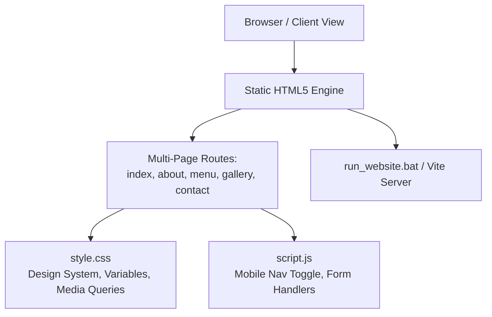

# 📐 Technical Architecture & Implementation Plan: Warm Heart Cafe and Bakery

## 1. Architecture Overview


## 2. Directory Hierarchy
```text
16. WARM HEART CAFE AND BAKERY (Cafe & Bakery Web Platform)/
├── .specify/
│   ├── memory/constitution.md
│   └── specs/warm-heart-cafe/
│       ├── spec.md
│       ├── plan.md
│       ├── tasks.md
│       └── checklist.md
├── assets/
│   └── .aistudio/
├── index.html       (Home & Hero)
├── about.html       (Story & Mission)
├── menu.html        (Categorized Drinks & Bakery)
├── gallery.html     (Visual Grid Showcase)
├── contact.html     (Inquiry & Form)
├── style.css        (Shared CSS & Mobile Breakpoints)
├── script.js        (Navigation Toggle & Form Validation)
├── package.json     (Vite + React + Tailwind Ready)
├── tsconfig.json    (TypeScript Configuration)
├── vite.config.ts   (Vite Build Configuration)
├── metadata.json    (AI Studio Project Metadata)
├── README.md        (Documentation)
└── run_website.bat  (1-Click Launcher)
```

## 3. Design System & Tokens
- **Primary Hue**: Warm Coffee (`#4A2E18`, `#6F4E37`)
- **Secondary Tone**: Cream & Milk (`#FFF8F0`, `#F5EBE1`)
- **Accent**: Warm Amber / Cinnamon Gold (`#D48B38`)
- **Breakpoints**: 768px (Mobile/Tablet transition), 1024px (Desktop Grid)
